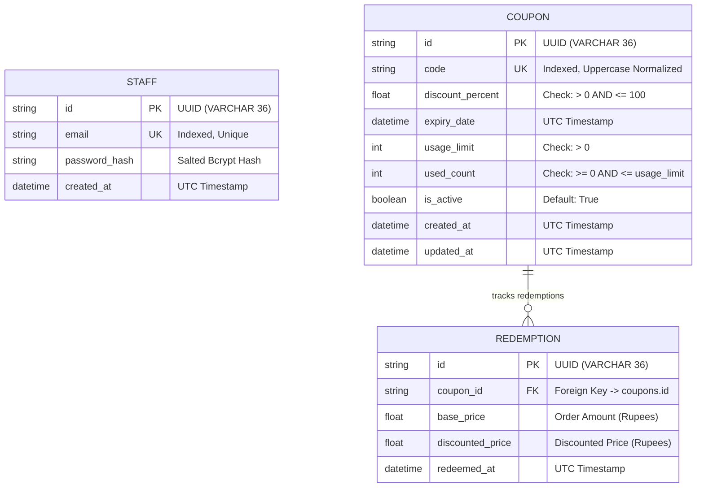

# Coupon Engine 🎫

[](https://coupon-engine-ceyh.onrender.com)
[](https://coupon-engine-ceyh.onrender.com/docs)
[](https://www.python.org/)
[](https://fastapi.tiangolo.com)
[](https://www.sqlalchemy.org/)
[](https://docs.pytest.org/)

An enterprise-ready, full-stack coupon management and validation engine built with **FastAPI**, **SQLAlchemy 2.0**, and **PostgreSQL/SQLite**. The engine features an atomic, race-condition-safe coupon validation and redemption pipeline, interactive public frontend portals, and a secure staff management dashboard.

---

## 📋 Table of Contents

- [Key Features](#-key-features)
- [Database Schema & Architecture](#-database-schema--architecture)
- [Test Credentials & Seed Matrix](#-test-credentials--seed-matrix)
- [Project Directory Structure](#-project-directory-structure)
- [Local Development & Quickstart](#-local-development--quickstart)
- [Automated Testing](#-automated-testing)
- [Live Deployment & Quick Links](#-live-deployment--quick-links)

---

## 🌟 Key Features

- **Public Coupon Redemption Portal (`/apply`)**:
  - Live coupon code validation against order amounts in Indian Rupees (₹).
  - Clear breakdown: Base Price, Discount %, Discounted Amount, and Total Savings.
  - User-friendly error messaging for expired, deactivated, or exhausted promo codes.
- **Strict Server-Side Validation Pipeline**:
  - Sequential rule evaluation hierarchy: `Code Existence` ➔ `Active Status` ➔ `Expiration Date` ➔ `Usage Limit`.
- **Race-Condition & Concurrency Safe**:
  - Database-level conditional atomic updates (`UPDATE coupons SET used_count = used_count + 1 WHERE ... AND used_count < usage_limit`).
  - Guarantees usage limits are never exceeded even under intense simultaneous bursts.
- **Secure Staff Portal (`/login` & `/dashboard`)**:
  - Salted bcrypt password hashing with secure JWT and HTTP-only session cookies.
  - Create new coupons with percentage discount, UTC expiration timestamp, and usage cap.
  - Real-time usage tracking (`used_count` vs `usage_limit`) with one-click instant deactivation.
- **Turnkey Seeding & Automated Migrations**:
  - Pre-seeded staff user and 5 distinct coupon states for immediate evaluation.
  - Database migrations powered by Alembic.

---

## 🗄️ Database Schema & Architecture

The database requires three core relational models: `Staff`, `Coupon`, and `Redemption`.

### Entity Relationship Diagram




### Model Specifications

1. **`staff`**:
   - `id` (`VARCHAR(36)`): Primary Key (UUID).
   - `email` (`VARCHAR(255)`): Unique, indexed login address.
   - `password_hash` (`VARCHAR(255)`): Secure salted bcrypt hash.
   - `created_at` (`DATETIME`): UTC creation timestamp.

2. **`coupons`**:
   - `id` (`VARCHAR(36)`): Primary Key (UUID).
   - `code` (`VARCHAR(50)`): Unique, indexed, uppercase coupon code.
   - `discount_percent` (`FLOAT`): Value between 0.1% and 100.0%.
   - `expiry_date` (`DATETIME`): UTC expiration deadline.
   - `usage_limit` (`INTEGER`): Maximum allowable redemptions across all users.
   - `used_count` (`INTEGER`): Counter of successful redemptions (`used_count <= usage_limit`).
   - `is_active` (`BOOLEAN`): Administrative toggle.
   - `created_at` / `updated_at` (`DATETIME`): UTC audit timestamps.

3. **`redemptions`**:
   - `id` (`VARCHAR(36)`): Primary Key (UUID).
   - `coupon_id` (`VARCHAR(36)`): Foreign Key referencing `coupons.id`.
   - `base_price` (`FLOAT`): Original order amount in Rupees (₹).
   - `discounted_price` (`FLOAT`): Final payable amount after discount in Rupees (₹).
   - `redeemed_at` (`DATETIME`): UTC timestamp of successful redemption.

---

## 🔑 Test Credentials & Seed Matrix

### Staff Login Credentials
- **Portal URL**: `/login`
- **Email**: `staff@couponengine.com`
- **Password**: `Password123!`
- **Role**: Staff Administrator

### Pre-Seeded Coupon Matrix
| Code | Discount | Expiry | Limit | Initial Used | State / Test Case |
| :--- | :--- | :--- | :--- | :--- | :--- |
| **`MARKETING26`** | 25% | +60 days | 200 | 0 | **Active & usable** (Standard promotional code) |
| **`ACTIVE20`** | 20% | +30 days | 50 | 2 | **Active & usable** (Partially redeemed) |
| **`EXPIRED10`** | 10% | -7 days | 100 | 5 | **Expired** (Rejection: Expired coupon) |
| **`MAXED50`** | 50% | +30 days | 5 | 5 | **Limit Reached** (Rejection: Usage limit exhausted) |
| **`DISABLED15`** | 15% | +30 days | 25 | 1 | **Deactivated** (Rejection: Inactive coupon) |

---

## 📂 Project Directory Structure

```text
coupon-engine/
├── .env.example              # Environment variables template
├── .gitignore                # Git ignore rules
├── alembic.ini               # Database migration configuration
├── Dockerfile                # Production container specification
├── Procfile                  # Process definition for Render / Heroku
├── pytest.ini                # Pytest configuration
├── README.md                 # Project documentation & live links
├── render.yaml               # Infrastructure-as-code for Render deployment
├── requirements.txt          # Production and testing dependencies
├── alembic/                  # Database migration scripts
│   ├── env.py
│   ├── script.py.mako
│   └── versions/             # Migration version files
├── app/                      # Application source code
│   ├── main.py               # FastAPI application factory and routes
│   ├── config.py             # Settings and environment validation
│   ├── database.py           # SQLAlchemy session and engine management
│   ├── api/                  # REST API routers (/auth, /coupons)
│   ├── models/               # SQLAlchemy ORM models (Staff, Coupon, Redemption)
│   ├── schemas/              # Pydantic validation schemas
│   ├── services/             # Core business logic & atomic operations
│   ├── static/               # Frontend CSS and static assets
│   └── templates/            # Jinja2 HTML templates (apply, login, dashboard)
├── docs/                     # Project documentation & visual assets
│   └── images/
│       └── er_diagram.png    # High-resolution database ER diagram
├── scripts/
│   └── seed.py               # Database initialization and seeding script
└── tests/                    # Automated test suite
    ├── conftest.py           # Pytest fixtures and test database setup
    ├── test_auth.py          # Authentication and route protection tests
    ├── test_concurrency.py   # Threaded race condition & limit tests
    └── test_coupons.py       # CRUD and validation rule pipeline tests
```

---

## 💻 Local Development & Quickstart

### 1. Prerequisites
- Python 3.10+ (tested on Python 3.11, 3.12, 3.14)
- Git

### 2. Clone Repository & Setup Virtual Environment
```bash
git clone https://github.com/<YOUR-USERNAME>/coupon-engine.git
cd coupon-engine

# Create virtual environment
python -m venv .venv

# Activate virtual environment
# On Windows:
.\.venv\Scripts\activate
# On Linux / macOS:
source .venv/bin/activate

# Install dependencies
pip install -r requirements.txt
```

### 3. Configure Environment Variables
Copy `.env.example` to `.env`:
```bash
cp .env.example .env
```
Default `.env` configuration:
```ini
ENVIRONMENT=development
SECRET_KEY=coupon_engine_super_secret_jwt_key_2026
ALGORITHM=HS256
ACCESS_TOKEN_EXPIRE_MINUTES=1440
DATABASE_URL=sqlite:///./coupon_engine.db
```

### 4. Initialize & Seed Database
Run the seed script to apply migrations, create tables, and populate seed records:
```bash
python -m scripts.seed
```

### 5. Launch Development Server
```bash
uvicorn app.main:app --reload --port 8000
```

Access the application in your browser:
- **Public Apply Portal**: [http://localhost:8000/apply](http://localhost:8000/apply)
- **Staff Admin Login**: [http://localhost:8000/login](http://localhost:8000/login)
- **Interactive Swagger Docs**: [http://localhost:8000/docs](http://localhost:8000/docs)

---

## 🧪 Automated Testing

Execute the complete test suite including authentication, validation rules, and multi-threaded race conditions:

```bash
pytest -v
```

### Test Suite Summary:
```text
tests/test_auth.py::test_staff_login_success PASSED                      [  8%]
tests/test_auth.py::test_staff_login_wrong_password PASSED               [ 16%]
tests/test_auth.py::test_staff_login_nonexistent_user PASSED             [ 25%]
tests/test_auth.py::test_protected_routes_without_auth PASSED            [ 33%]
tests/test_concurrency.py::test_concurrent_coupon_redemptions PASSED     [ 41%]
tests/test_coupons.py::test_create_and_list_coupons PASSED               [ 50%]
tests/test_coupons.py::test_duplicate_coupon_creation PASSED             [ 58%]
tests/test_coupons.py::test_deactivate_coupon PASSED                     [ 66%]
tests/test_coupons.py::test_apply_coupon_success PASSED                  [ 75%]
tests/test_coupons.py::test_apply_nonexistent_coupon PASSED              [ 83%]
tests/test_coupons.py::test_apply_expired_coupon PASSED                  [ 91%]
tests/test_coupons.py::test_apply_maxed_coupon PASSED                    [100%]

======================== 12 passed in 3.66s ========================
```

---

## 🌐 Live Deployment & Quick Links

| Resource | Live Link / Route | Description |
| :--- | :--- | :--- |
| 🚀 **Live Application** | [https://coupon-engine-ceyh.onrender.com](https://coupon-engine-ceyh.onrender.com) | Root redirect to Public Apply Portal |
| 🎫 **Public Apply Portal** | [https://coupon-engine-ceyh.onrender.com/apply](https://coupon-engine-ceyh.onrender.com/apply) | Interactive coupon validation and redemption |
| 🔐 **Staff Admin Login** | [https://coupon-engine-ceyh.onrender.com/login](https://coupon-engine-ceyh.onrender.com/login) | Administrator portal to manage & track coupons |
| 📖 **Interactive Swagger Docs** | [https://coupon-engine-ceyh.onrender.com/docs](https://coupon-engine-ceyh.onrender.com/docs) | Live OpenAPI / Swagger interactive documentation |
